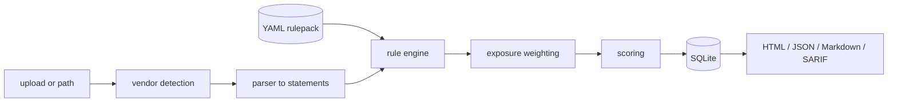

# netaudit


**Policy-as-code gate for network devices.** Audit FortiGate and Cisco IOS configurations
against a declarative baseline, get a scored report with remediation, and fail the
pipeline when the score drops. Findings export as SARIF, so they land in code scanning
instead of a wiki page nobody re-reads.

> Status: beta, no auth, single worker. Intended as a CI gate over exported configs, not a
> live auditor. Limitations are at the bottom, unmade-up.


Manual config review does not scale and it is inconsistent between engineers. NetAudit
makes the baseline explicit, reviewable and versionable: a new check is a YAML change plus
a fixture, never a change to the analysis code.

## Why a gate and not a scanner

A scanner produces a report. A gate produces an exit code. Exit codes are the only thing
CI can act on, so the finding model is built for exit codes from the start: deterministic,
weighted, threshold-driven, with `--fail-under`.

## Blast radius

Severity alone ranks a lab interface the same as a WAN interface. Every rule declares an
exposure class and the score multiplies severity by it:

| Exposure | Multiplier | Example |
| --- | --- | --- |
| `internet` | 1.5 | WAN policy, public admin GUI |
| `management` | 1.2 | trust host, AAA, VTY |
| `internal` | 1.0 | LAN policy, logging |

An `any-any` policy on WAN outranks the same policy on an internal segment. The
multiplier is deterministic and printed per finding.

## Quickstart

```bash
git clone https://github.com/LeoAra03/netaudit && cd netaudit
python -m venv .venv && source .venv/bin/activate
pip install -e ".[dev]"
make verify
netaudit scan tests/fixtures/fortigate_bad.conf --fail-under 80
```

**Live demo:** https://<url> — no auth, no rate limit, do not upload real configs. It
restarts on its own.

## CLI

```bash
netaudit scan device.conf                    # table
netaudit scan device.conf --format sarif > out.sarif
netaudit scan device.conf --fail-under 80    # exit 1 below threshold
netaudit scan device.conf --explain          # path|key=value evidence + rulepack line
netaudit diff before.conf after.conf         # new and fixed findings
netaudit diff before.conf after.conf --format json
netaudit explain FG-009                      # control, rationale, remediation
```

`--explain` prints the normalized `path|key=value` statement, the rulepack source
line, and the exact `match`/`scope` that fired.
`diff` compares two snapshots of the same vendor and reports **newly introduced and
fixed findings**. It returns `1` if the newer snapshot introduces a finding, so it can
gate a change; `0` means no new findings. It cannot verify device identity, so compare
snapshots from the same device yourself.

Exit codes: `0` clean scan, scan above threshold, or diff with no new findings; `1` scan
below `--fail-under` or diff with newly introduced findings; `2` unreadable file,
undetectable vendor, invalid cross-vendor diff, or `explain` on a rule id nobody defines;
`3` schema-invalid rulepack.

## Use it in CI

```yaml
- uses: LeoAra03/netaudit/.github/actions/netaudit-action@v0.2.0
  with:
    config: exported/edge-fw.conf
    fail-under: 85
```

## Control mapping

Every rule maps to at least one external control, so a finding can be argued in an audit
rather than in taste. See [docs/control-mapping.md](docs/control-mapping.md). The mapping
is informative, not a certification.

## Architecture



Parsers only emit `Statement(path, key, value, object)`. Rules only match
`path|key=value`. Neither layer knows the other's internals, so a new vendor is one parser
plus one pack, and a new check is one YAML entry plus one fixture.

## Rules

| id | severity | exposure | check |
|----|----------|----------|-------|
| FG-001 | high | management | telnet administration enabled |
| FG-007 | high | management | admin trusted host unrestricted |
| FG-009 | medium | internet | firewall policy permits any-any |
| CS-001 | high | management | VTY lines accept telnet |
| CS-005 | high | management | AAA not enabled |

Full packs and references in [`src/netaudit/rulepacks/`](src/netaudit/rulepacks). `id`,
`severity`, `exposure`, `match`, `expect` and `scope` are validated at pack load, so a
typo fails the run instead of reporting a clean device.

The full rule-to-control crosswalk, with exact section identifiers, titles, and
non-equivalent mappings called out, is in
[`docs/cis-control-mapping.md`](docs/cis-control-mapping.md). The FortiGate rules target
FortiOS 7.6 syntax, but the crosswalk cites the verifiable CIS FortiGate 7.4.x v1.0.0
edition; it does not imply a 7.6-specific CIS certification.

## Scoring

`max(0, 100 - sum(severity_weight * exposure_multiplier))`, graded A-F. Deterministic and
deliberately crude: a triage order, not a compliance statement. The severity labels are
local triage guidance; see [`docs/severity-rationale.md`](docs/severity-rationale.md) for
why FG-001 is High and FG-004 is Low.

## Security posture

Multi-stage non-root image, read-only rootfs in compose, Trivy gate on HIGH and CRITICAL,
SBOM published per release, keyless cosign signature, OIDC deploy with no long-lived cloud
secret, `[tool.bandit]` in CI.

## Deploy

```bash
az deployment group create -g rg-netaudit -f infra/main.bicep \
  -p image=ghcr.io/LeoAra03/netaudit:v0.2.0
```

## Known limitations

- One file per scan. No SSH or NETCONF collector, so no live polling.
- Regex heuristics produce false positives and negatives; every rule has a positive and a
  negative fixture, but fixtures are not the protocol.
- Rulepacks are my reading of hardening guidance, not certified CIS benchmarks.
- Findings collapse per rule, not per object.
- SQLite, single worker, no horizontal scale.
- No auth, no rate limiting, no retention. The public demo is unauthenticated by design.

## Roadmap

- [ ] Per-object aggregation
- [ ] `regex_timeout` guard for hostile input
- [ ] Postgres backend for multi-worker
- [ ] Jump-host collector for running-config
- [ ] Terraform provider

## Tests

99 tests, full library coverage. `make test`, `make cov`. CI runs 3.11 and 3.12.

## AI assistance

Built with Claude Code and Copilot under a written discipline: contract first, prompt,
then lint/types/tests on every suggestion. Rejected suggestions and the test that caught
each are in [docs/ai-workflow.md](docs/ai-workflow.md).

## Author

Leonardo Araya — cloud security and infrastructure automation. Issues and pull requests
welcome.

## License

MIT.
