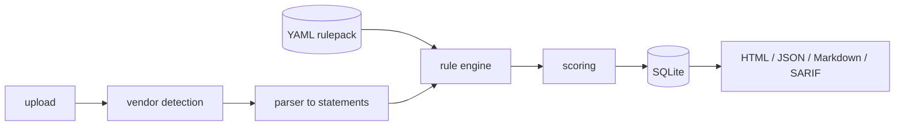

# NetAudit

[](https://github.com/LeoAra03/netaudit/actions/workflows/ci.yml)
[](https://github.com/LeoAra03/netaudit/blob/main/pyproject.toml)
[](https://github.com/LeoAra03/netaudit/blob/main/pyproject.toml)
[](https://github.com/LeoAra03/netaudit/blob/main/LICENSE)


**Status:** functional beta, no auth, no multi-worker. Intended use: CI gate over exported configs, not live auditing. Limitations at the end of this document, no cosmetics.

**Versioned hardening baseline for FortiGate and Cisco, enforced as a CI gate. Findings are data, not a wiki page that rots.**

Audit FortiGate and Cisco IOS configurations against a declarative baseline and get a
scored report with remediation steps. It ships as a CLI gate and a small web UI, and it
exports SARIF so the findings show up in code scanning.

I built this because I kept re-reviewing the same kinds of mistakes on lab configs:
telnet left on, `any any` policy, no syslog. A checklist in a wiki page never stays
current, so I made the checklist data instead.

## Why

Manual config review does not scale and it is inconsistent between engineers. NetAudit
makes the baseline explicit, reviewable and versionable: adding a check is a YAML change
plus a fixture, not a change to the analysis code.

## Quickstart

```bash
git clone https://github.com/LeoAra03/netaudit && cd netaudit
python -m venv .venv && source .venv/bin/activate
pip install -e ".[dev]"
make verify                      # lint + types + tests with coverage
make run                         # http://localhost:8000
netaudit scan tests/fixtures/fortigate_bad.conf --fail-under 80
```

Python 3.11 or newer. CI runs 3.11 and 3.12.

## CLI

```bash
netaudit scan device.conf                        # table, human readable
netaudit scan device.conf --format json
netaudit scan device.conf --format sarif > out.sarif
netaudit scan device.conf --format markdown
netaudit scan device.conf --fail-under 80        # exit 1 below threshold
netaudit scan device.conf --explain             # print path|key=value evidence
netaudit diff before.conf after.conf            # gate only on newly introduced findings
netaudit diff before.conf after.conf --format json
```

`--explain` prints the normalized `path|key=value` statement, the rulepack source line,
and the exact `match`/`scope` that fired.
`diff` compares two snapshots of the same vendor and emits **only newly introduced
findings**. It returns `1` if the newer snapshot introduces a finding, so it can gate a
change; `0` means no new findings. It cannot verify device identity, so compare snapshots
from the same device yourself.

Exit codes: `0` clean scan, scan above threshold, or diff with no new findings; `1` scan
below `--fail-under` or diff with newly introduced findings; `2` unreadable file,
undetectable vendor, or invalid cross-vendor diff.

## HTTP API

```bash
curl -F 'file=@tests/fixtures/cisco_bad.conf' -F 'fail_under=90' localhost:8000/api/scans
curl -s localhost:8000/scans/<id>/report.sarif
```

| route | what it gives you |
|---|---|
| `POST /api/scans` | JSON with `score`, `grade`, `findings`, `id` (422 if below `fail_under`) |
| `POST /scan` | same audit from a browser form, redirects to the report |
| `GET /scans/{id}` | HTML report |
| `GET /scans/{id}/report.md` | Markdown for a ticket or a wiki |
| `GET /scans/{id}/report.sarif` | SARIF 2.1.0 for code scanning |
| `GET /healthz` | liveness probe used by the container and by Azure |

Interactive docs at `/docs` while the server is up.

## Rules

| id | severity | check |
|----|----------|-------|
| FG-001 | high | telnet administration enabled |
| FG-002 | medium | legacy TLS on the admin GUI |
| FG-003 | medium | plain HTTP allowed on an interface |
| FG-004 | low | default SNMP community |
| FG-005 | medium | password policy block missing |
| FG-006 | high | password policy disabled |
| FG-007 | high | admin trusted host unrestricted |
| FG-008 | medium | logging disabled |
| FG-009 | medium | firewall policy permits any-any |
| CS-001 | high | VTY lines accept telnet |
| CS-002 | medium | HTTP server enabled |
| CS-003 | low | default SNMP community |
| CS-004 | medium | `service password-encryption` absent |
| CS-005 | high | AAA not enabled |
| CS-006 | low | no syslog host configured |
| CS-007 | high | cleartext password on a local user |

The full rule-to-control crosswalk, with exact section identifiers, titles, and
non-equivalent mappings called out, is in
[`docs/cis-control-mapping.md`](docs/cis-control-mapping.md). The FortiGate rules target
FortiOS 7.6 syntax, but the crosswalk cites the verifiable CIS FortiGate 7.4.x v1.0.0
edition; it does not imply a 7.6-specific CIS certification. Rule definitions and their
short operator-facing references live in [`src/netaudit/rulepacks/`](src/netaudit/rulepacks).
A rule looks like this:

```yaml
- id: FG-001
  title: Telnet administration enabled
  severity: high
  scope: ["system.global"]                     # fnmatch on the statement path
  match: '^system\.global\|admin-telnet=enable' # regex on "path|key=value"
  remediation: "set admin-telnet disable; keep SSH and HTTPS only."
```

`expect: present` inverts the rule and fires when nothing matches (that is how CS-005
catches a missing `aaa new-model`). `id`, `severity`, `match`, `expect` and `scope` are
validated when the pack loads, so a typo fails the run instead of quietly reporting a
clean device.

## Scoring

Each finding carries a weight (info 1, low 2, medium 5, high 10, critical 20). The score
is `max(0, 100 - total weight)`, graded A to F. It is deterministic and deliberately
crude: it is a triage order, not a compliance statement. The severity labels are local
triage guidance; see [`docs/severity-rationale.md`](docs/severity-rationale.md) for why
FG-001 is High and FG-004 is Low.

## Architecture



Parsers only produce `Statement(path, key, value, object)`; rules only match
`path|key=value`. Neither layer knows the other's internals, so adding a vendor means one
parser plus one pack, and adding a check means one YAML entry plus one fixture.

## Run it in Docker

```bash
make docker            # or: docker build -t netaudit:dev .
docker compose up --build
curl -s localhost:8000/healthz
```

The image is multi-stage, runs as a non-root user, and compose mounts a read-only rootfs
with a single writable volume for the database.

## Deploy

```bash
az group create -n rg-netaudit -l eastus
az deployment group create -g rg-netaudit -f infra/main.bicep \
  -p image=ghcr.io/LeoAra03/netaudit:v0.1.0
```

Images build in CI, are gated by Trivy on HIGH and CRITICAL, and deploy on tag through
OIDC federation (no long-lived cloud secret in the repo). The Container App scales to zero.

## Known limitations

I would rather list these than have someone find them:

- One file per scan. No SSH/NETCONF collector, so no live polling.
- Regex heuristics produce false positives and false negatives; every rule has a fixture,
  but the fixtures are not the whole protocol.
- The rulepacks are my reading of hardening guidance, not certified CIS benchmarks.
- Findings collapse per rule, not per object: a config with five bad interfaces gives one
  FG-003 with the first piece of evidence.
- SQLite plus a single worker. No horizontal scale.
- No auth, no rate limiting, no retention policy. Do not expose this to the internet with
  real configs on disk. See [docs/threat-model.md](docs/threat-model.md).

## Roadmap

- [ ] Auth and per-user history
- [ ] Per-object aggregation, so each bad interface is its own finding
- [ ] `regex_timeout` guard for catastrophic patterns on hostile input
- [ ] Postgres backend for multi-worker deployments
- [ ] A device connector that pulls a running-config behind a jump host

## Tests

67 tests, 100% coverage on the library (the CLI is exercised through its exit codes and
excluded from the coverage number on purpose).

```bash
make test
make cov
```

## AI assistance

Built with Claude Code and Copilot under a review discipline I wrote down: contract first,
then prompt, then lint/types/tests on every suggestion. The rejected suggestions and the
test that caught each one are logged in [docs/ai-workflow.md](docs/ai-workflow.md).

## License

MIT. See [LICENSE](LICENSE).

## Author

Leonardo Araya — personal network security project. Issues and pull requests are welcome; details of the AI-assisted review process are in [docs/ai-workflow.md](docs/ai-workflow.md).
